# 一维 Euler 方程统一求解器测试报告

本报告由统一的 FV/DG 求解器自动生成。程序支持单介质与双介质（单个移动界面）一维 Euler 方程组，数值格式、网格、流体参数与初始条件均由 JSON 配置。

> 由 `run_euler.m` 读取 `dg_single_smooth.json`、`dg_single_sod.json`、`dg_two_gamma_sod.json`、`dg_two_smooth.json`、`dg_two_sod.json`、`fv_single_smooth.json`、`fv_single_sod.json`、`fv_two_sod.json` 自动生成。
> 生成时间：2026-11-06 01:56:26

## 算例汇总

| # | 算例 | 格式 | 介质 | 阶数 | 通量 | 单元数 | 终止时间 | 步数 | 界面位置 | rho L1 | rho L∞ |
| ---: | --- | --- | --- | ---: | --- | ---: | ---: | ---: | ---: | ---: | ---: |
| 1 | dg_single_smooth | DG | 单介质 | 2 | LLF | 160 | 2 | 3716 | — | 1.234e-04 | 0.00123901 |
| 2 | dg_single_sod | DG | 单介质 | 2 | LLF | 200 | 0.15 | 650 | — | 0.00304367 | 0.0765174 |
| 3 | dg_two_gamma_sod | DG | 多介质 | 2 | LLF | 100 | 0.15 | 347 | 0.635234 | 0.00796578 | 0.109969 |
| 4 | dg_two_smooth | DG | 多介质 | 2 | LLF | 80 | 1 | 929 | 1.5 | 0.00131957 | 0.013536 |
| 5 | dg_two_sod | DG | 多介质 | 2 | LLF | 100 | 0.15 | 317 | 0.639355 | 0.00721157 | 0.0538764 |
| 6 | fv_single_smooth | FV | 单介质 | 2 | LLF | 200 | 1 | 581 | — | 5.017e-04 | 0.00310593 |
| 7 | fv_single_sod | FV | 单介质 | 2 | LLF | 400 | 0.15 | 327 | — | 0.003062 | 0.0885354 |
| 8 | fv_two_sod | FV | 多介质 | 1 | LLF | 200 | 0.15 | 325 | 0.639275 | 0.0121897 | 0.0803423 |

数值解以蓝色实线表示，精确解以橙色虚线表示。双介质算例的界面位置由界面黎曼问题推进，并在表中给出终了位置。

## 数值方法

- 单介质有限体积：一阶 LLF/HLL/HLLC，或 MUSCL + minmod 二阶重构；时间推进采用 SSP-RK2。
- 单介质 DG：P0/P1/P2 Legendre 基，LLF/HLL/HLLC 数值通量，特征变量 TVB/minmod 限制器，SSP-RK2/RK3。
- 双介质：界面所在单元用两相切割单元表示，界面速度由刚性气体精确黎曼求解器给出，相内数据采用 P0（等价于一阶 FV）或 P1/P2 DG 多项式。

## 算例结果

## 1. dg_single_smooth

单介质 DG P2 格式求解周期光滑密度波的输运问题。

**计算参数**

| 参数 | 值 |
| --- | ---: |
| 格式 | DG，2 阶 |
| 介质 | 单介质 |
| 数值通量 | LLF |
| 计算区域 | $x\in[0,2]$，160 个单元 |
| 边界条件 | periodic |
| 终止时间 / CFL | 2 / 0.1 |
| 时间步数 | 3716 |

**流体参数**

| 参数 | 值 |
| --- | ---: |
| gamma | 1.4 |
| p_inf | 0 |
**初始条件**

| 参数 | 值 |
| --- | ---: |
| 密度 | $\rho_0 + \rho_a\sin(k\pi x)$，$\rho_0=1$，$\rho_a=0.2$，$k=1$ |
| 速度 | 1 |
| 压强 | 1 |
**误差（相对精确解）**

| 量 | L1 | L∞ |
| --- | ---: | ---: |
| 密度 | 1.234e-04 | 0.00123901 |
| 速度 | 4.189e-15 | 1.377e-14 |
| 压强 | 2.234e-13 | 2.397e-13 |

**结果图像**

| 密度 $\rho$ | 速度 $u$ | 压强 $p$ |
| :---: | :---: | :---: |
| 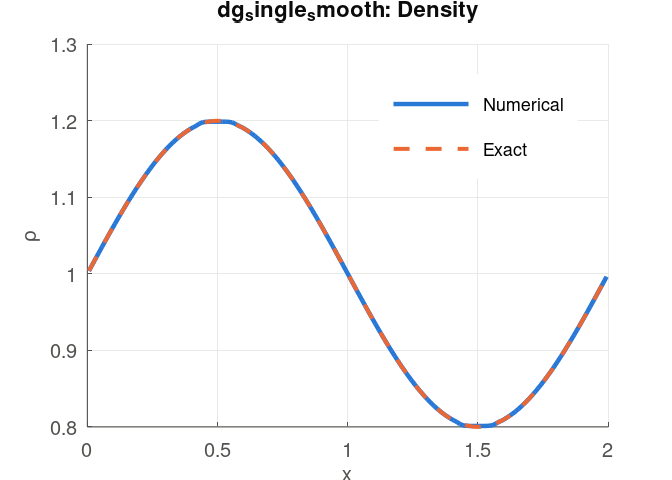 | 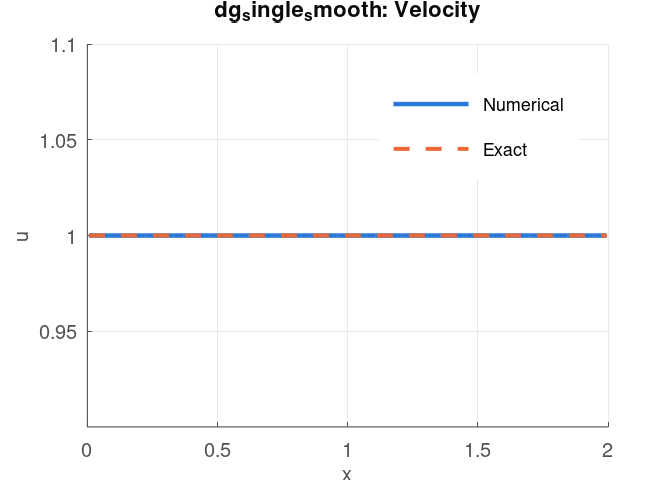 | 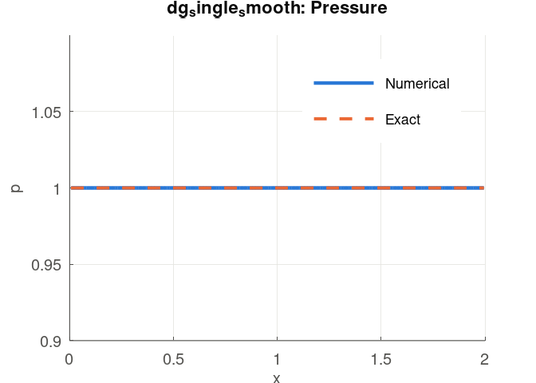 |

三联图：[overview.png](figures/dg_single_smooth/overview.png)


## 2. dg_single_sod

单介质 DG P2 格式求解 Sod 激波管问题。

**计算参数**

| 参数 | 值 |
| --- | ---: |
| 格式 | DG，2 阶 |
| 介质 | 单介质 |
| 数值通量 | LLF |
| 计算区域 | $x\in[0,1]$，200 个单元 |
| 边界条件 | transmissive |
| 终止时间 / CFL | 0.15 / 0.1 |
| 时间步数 | 650 |

**流体参数**

| 参数 | 值 |
| --- | ---: |
| gamma | 1.4 |
| p_inf | 0 |
**初始条件**

| 参数 | 左状态 | 右状态 |
| --- | ---: | ---: |
| rho | 1 | 0.125 |
| u | 0 | 0 |
| p | 1 | 0.1 |
**误差（相对精确解）**

| 量 | L1 | L∞ |
| --- | ---: | ---: |
| 密度 | 0.00304367 | 0.0765174 |
| 速度 | 0.00645939 | 0.344206 |
| 压强 | 0.00261497 | 0.0994189 |

**结果图像**

| 密度 $\rho$ | 速度 $u$ | 压强 $p$ |
| :---: | :---: | :---: |
| 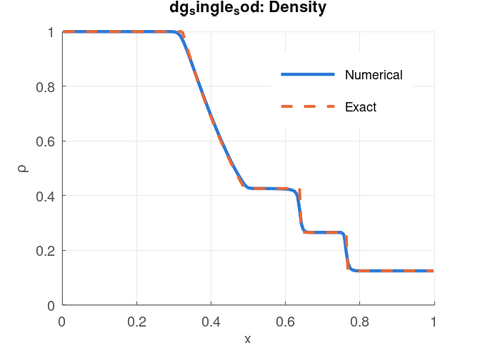 | 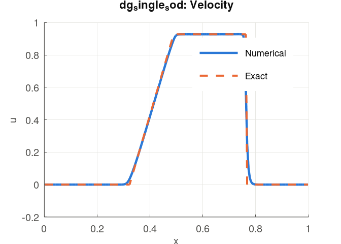 | 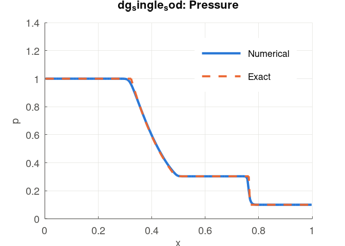 |

三联图：[overview.png](figures/dg_single_sod/overview.png)


## 3. dg_two_gamma_sod

双介质 DG P2 格式求解左右比热比不同的 Sod 激波管问题，检验介质界面与黎曼求解器。

**计算参数**

| 参数 | 值 |
| --- | ---: |
| 格式 | DG，2 阶 |
| 介质 | 双介质（单个移动界面） |
| 数值通量 | LLF |
| 计算区域 | $x\in[0,1]$，100 个单元 |
| 边界条件 | transmissive |
| 终止时间 / CFL | 0.15 / 0.1 |
| 时间步数 | 347 |
| 界面终了位置 | 0.635234 |

**流体参数**

| 参数 | 左介质 | 右介质 |
| --- | ---: | ---: |
| gamma | 1.4 | 1.667 |
| p_inf | 0 | 0 |
**初始条件**

| 参数 | 左状态 | 右状态 |
| --- | ---: | ---: |
| rho | 1 | 0.125 |
| u | 0 | 0 |
| p | 1 | 0.1 |
**误差（相对精确解）**

| 量 | L1 | L∞ |
| --- | ---: | ---: |
| 密度 | 0.00796578 | 0.109969 |
| 速度 | 0.0166265 | 0.375074 |
| 压强 | 0.00764595 | 0.112043 |

**结果图像**

| 密度 $\rho$ | 速度 $u$ | 压强 $p$ |
| :---: | :---: | :---: |
| 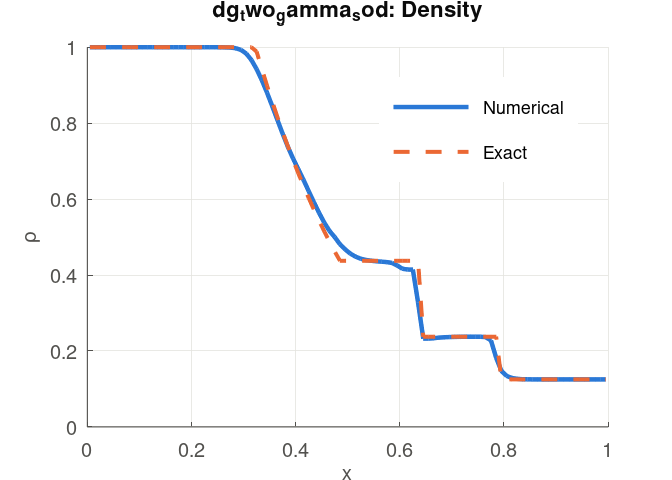 | 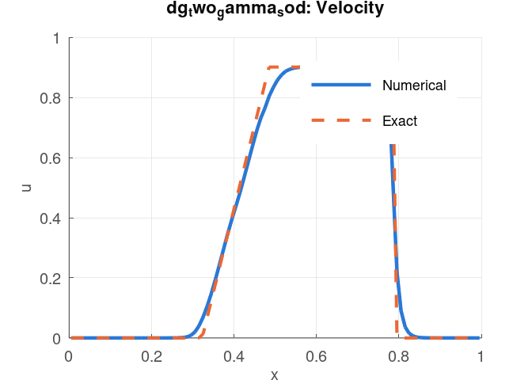 | 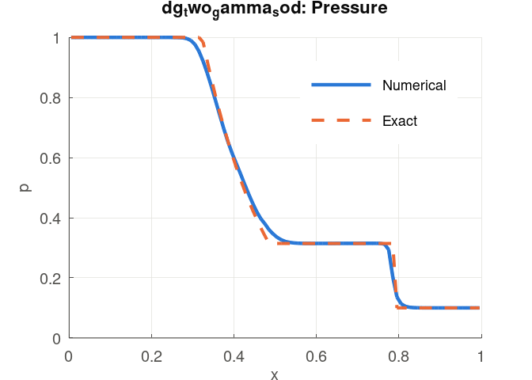 |

三联图：[overview.png](figures/dg_two_gamma_sod/overview.png)


## 4. dg_two_smooth

双介质切割单元 DG P2 格式求解周期光滑密度波输运（界面仅作为介质标记）。

**计算参数**

| 参数 | 值 |
| --- | ---: |
| 格式 | DG，2 阶 |
| 介质 | 双介质（单个移动界面） |
| 数值通量 | LLF |
| 计算区域 | $x\in[0,2]$，80 个单元 |
| 边界条件 | periodic |
| 终止时间 / CFL | 1 / 0.1 |
| 时间步数 | 929 |
| 界面终了位置 | 1.5 |

**流体参数**

| 参数 | 左介质 | 右介质 |
| --- | ---: | ---: |
| gamma | 1.4 | 1.4 |
| p_inf | 0 | 0 |
**初始条件**

| 参数 | 值 |
| --- | ---: |
| 密度 | $\rho_0 + \rho_a\sin(k\pi x)$，$\rho_0=1$，$\rho_a=0.2$，$k=1$ |
| 速度 | 1 |
| 压强 | 1 |
**误差（相对精确解）**

| 量 | L1 | L∞ |
| --- | ---: | ---: |
| 密度 | 0.00131957 | 0.013536 |
| 速度 | 7.050e-15 | 2.864e-14 |
| 压强 | 5.589e-14 | 6.906e-14 |

**结果图像**

| 密度 $\rho$ | 速度 $u$ | 压强 $p$ |
| :---: | :---: | :---: |
| 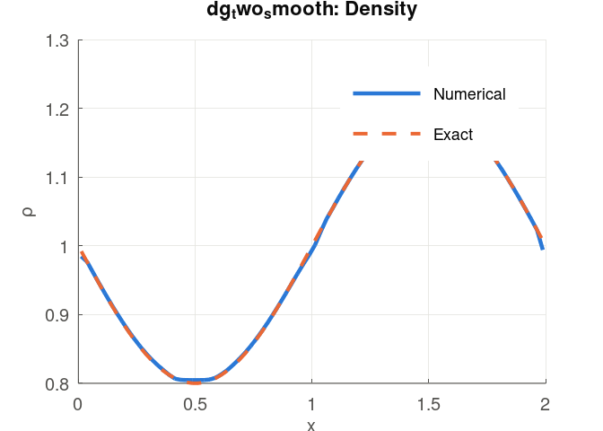 | 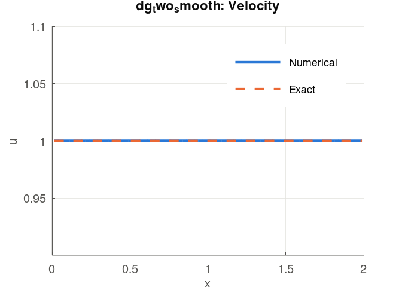 |  |

三联图：[overview.png](figures/dg_two_smooth/overview.png)


## 5. dg_two_sod

双介质切割单元 DG P2 格式求解 Sod 激波管问题（左右介质参数相同）。

**计算参数**

| 参数 | 值 |
| --- | ---: |
| 格式 | DG，2 阶 |
| 介质 | 双介质（单个移动界面） |
| 数值通量 | LLF |
| 计算区域 | $x\in[0,1]$，100 个单元 |
| 边界条件 | transmissive |
| 终止时间 / CFL | 0.15 / 0.1 |
| 时间步数 | 317 |
| 界面终了位置 | 0.639355 |

**流体参数**

| 参数 | 左介质 | 右介质 |
| --- | ---: | ---: |
| gamma | 1.4 | 1.4 |
| p_inf | 0 | 0 |
**初始条件**

| 参数 | 左状态 | 右状态 |
| --- | ---: | ---: |
| rho | 1 | 0.125 |
| u | 0 | 0 |
| p | 1 | 0.1 |
**误差（相对精确解）**

| 量 | L1 | L∞ |
| --- | ---: | ---: |
| 密度 | 0.00721157 | 0.0538764 |
| 速度 | 0.0171005 | 0.441937 |
| 压强 | 0.0072048 | 0.072955 |

**结果图像**

| 密度 $\rho$ | 速度 $u$ | 压强 $p$ |
| :---: | :---: | :---: |
| 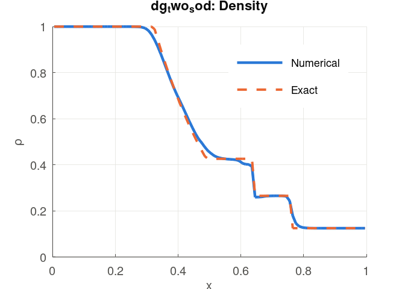 | 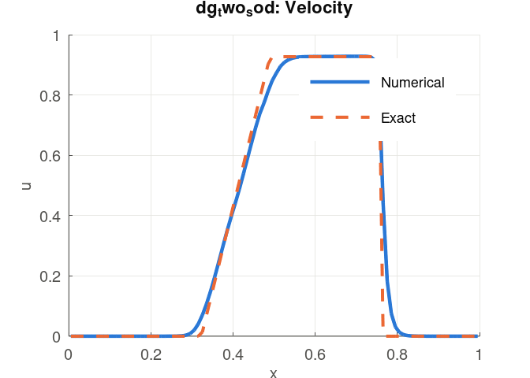 | 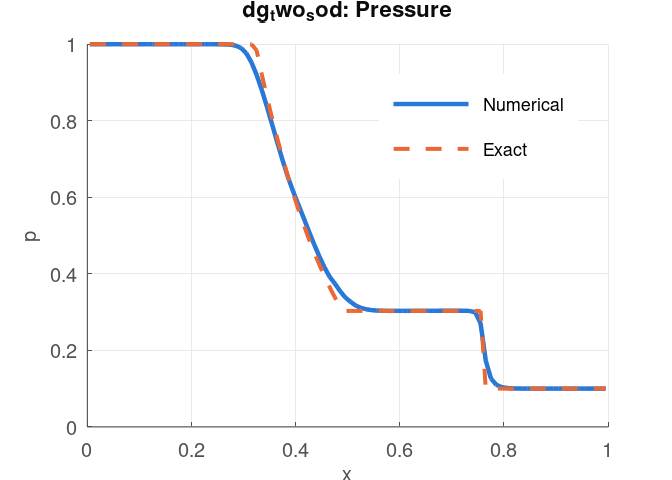 |

三联图：[overview.png](figures/dg_two_sod/overview.png)


## 6. fv_single_smooth

单介质有限体积二阶格式求解周期光滑密度波的输运问题。

**计算参数**

| 参数 | 值 |
| --- | ---: |
| 格式 | FV，2 阶 |
| 介质 | 单介质 |
| 数值通量 | LLF |
| 计算区域 | $x\in[0,2]$，200 个单元 |
| 边界条件 | periodic |
| 终止时间 / CFL | 1 / 0.4 |
| 时间步数 | 581 |

**流体参数**

| 参数 | 值 |
| --- | ---: |
| gamma | 1.4 |
| p_inf | 0 |
**初始条件**

| 参数 | 值 |
| --- | ---: |
| 密度 | $\rho_0 + \rho_a\sin(k\pi x)$，$\rho_0=1$，$\rho_a=0.2$，$k=1$ |
| 速度 | 1 |
| 压强 | 1 |
**误差（相对精确解）**

| 量 | L1 | L∞ |
| --- | ---: | ---: |
| 密度 | 5.017e-04 | 0.00310593 |
| 速度 | 8.560e-16 | 2.998e-15 |
| 压强 | 9.748e-16 | 4.885e-15 |

**结果图像**

| 密度 $\rho$ | 速度 $u$ | 压强 $p$ |
| :---: | :---: | :---: |
| 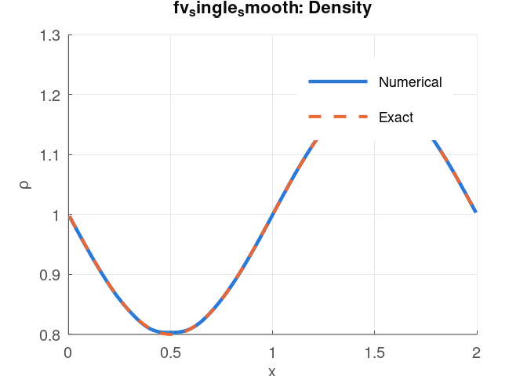 | 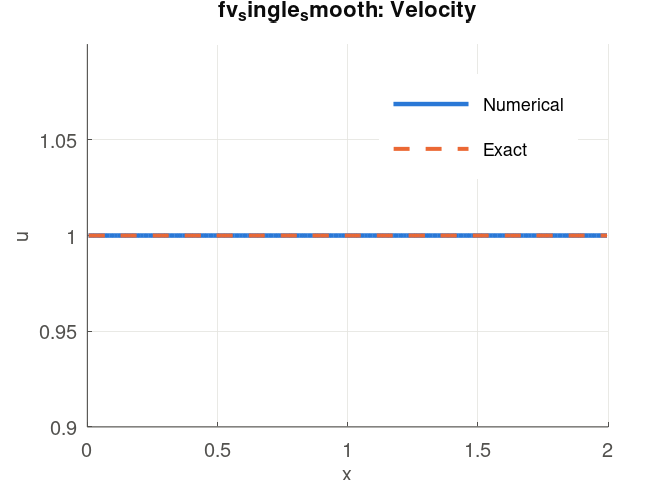 | 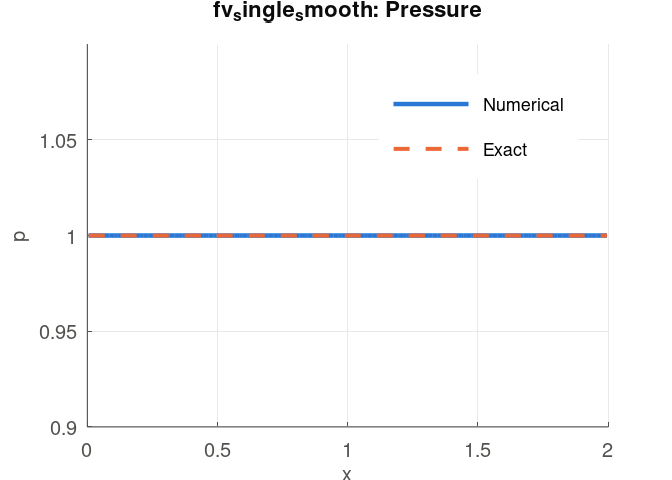 |

三联图：[overview.png](figures/fv_single_smooth/overview.png)


## 7. fv_single_sod

单介质有限体积二阶 MUSCL 格式求解经典 Sod 激波管问题。

**计算参数**

| 参数 | 值 |
| --- | ---: |
| 格式 | FV，2 阶 |
| 介质 | 单介质 |
| 数值通量 | LLF |
| 计算区域 | $x\in[0,1]$，400 个单元 |
| 边界条件 | transmissive |
| 终止时间 / CFL | 0.15 / 0.4 |
| 时间步数 | 327 |

**流体参数**

| 参数 | 值 |
| --- | ---: |
| gamma | 1.4 |
| p_inf | 0 |
**初始条件**

| 参数 | 左状态 | 右状态 |
| --- | ---: | ---: |
| rho | 1 | 0.125 |
| u | 0 | 0 |
| p | 1 | 0.1 |
**误差（相对精确解）**

| 量 | L1 | L∞ |
| --- | ---: | ---: |
| 密度 | 0.003062 | 0.0885354 |
| 速度 | 0.00477701 | 0.549125 |
| 压强 | 0.00210143 | 0.0963359 |

**结果图像**

| 密度 $\rho$ | 速度 $u$ | 压强 $p$ |
| :---: | :---: | :---: |
| 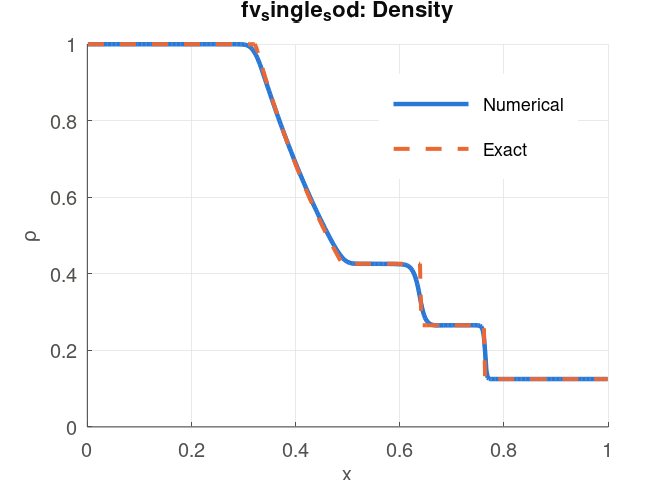 | 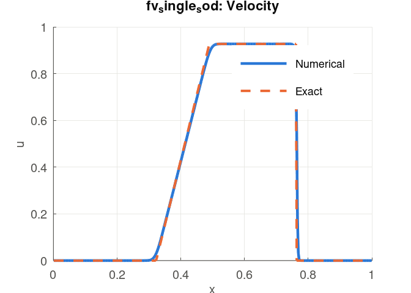 | 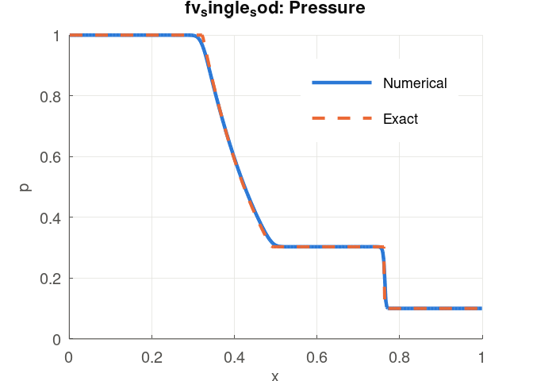 |

三联图：[overview.png](figures/fv_single_sod/overview.png)


## 8. fv_two_sod

双介质切割单元一阶有限体积格式求解 Sod 激波管问题（左右介质参数相同）。

**计算参数**

| 参数 | 值 |
| --- | ---: |
| 格式 | FV，1 阶 |
| 介质 | 双介质（单个移动界面） |
| 数值通量 | LLF |
| 计算区域 | $x\in[0,1]$，200 个单元 |
| 边界条件 | transmissive |
| 终止时间 / CFL | 0.15 / 0.2 |
| 时间步数 | 325 |
| 界面终了位置 | 0.639275 |

**流体参数**

| 参数 | 左介质 | 右介质 |
| --- | ---: | ---: |
| gamma | 1.4 | 1.4 |
| p_inf | 0 | 0 |
**初始条件**

| 参数 | 左状态 | 右状态 |
| --- | ---: | ---: |
| rho | 1 | 0.125 |
| u | 0 | 0 |
| p | 1 | 0.1 |
**误差（相对精确解）**

| 量 | L1 | L∞ |
| --- | ---: | ---: |
| 密度 | 0.0121897 | 0.0803423 |
| 速度 | 0.0264545 | 0.49879 |
| 压强 | 0.0136929 | 0.110242 |

**结果图像**

| 密度 $\rho$ | 速度 $u$ | 压强 $p$ |
| :---: | :---: | :---: |
| 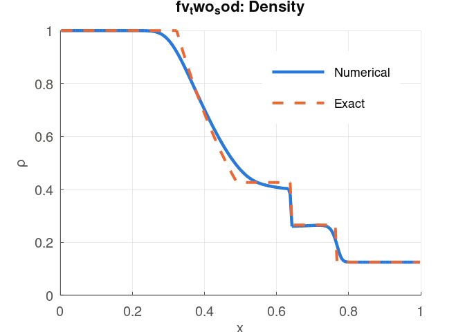 | 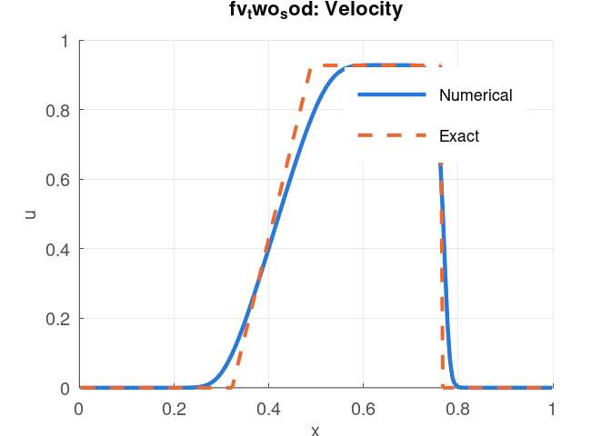 | 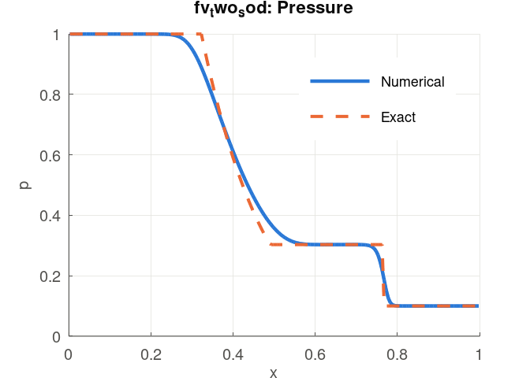 |

三联图：[overview.png](figures/fv_two_sod/overview.png)


## 复现方式

```matlab
cd CFD/Euler/matlab
run_euler                       % 运行 configs/ 下全部算例并生成 report.md
run_euler --list                % 列出全部算例
run_euler --case fv_single_sod
run_euler --config configs/fv_single_sod.json
```

新增算例只需在 `configs/` 下添加 JSON 文件，无需修改求解器代码。
