# 刚性气体黎曼问题精确解测试报告

一维 Euler 方程组的精确 Riemann 求解器测试。包括刚性气体（stiffened gas）、 爆轰波（强爆轰与 CJ 爆轰）以及爆燃波算例。

> 由 `code/run_cases.py` 读取 `code/cases.yaml` 自动生成。
> 生成时间：2026-11-02 01:07:50

## 算例汇总

| # | 算例 | 类型 | p* (Pa) | u* (m/s) | 左波 | 右波 |
| ---: | --- | --- | ---: | ---: | --- | --- |
| 1 | inert_sod | 非反应（刚性气体） | 0.314397 | 0.901378 | 稀疏波 | 激波 |
| 2 | inert_stiffened_gas | 非反应（刚性气体） | 0.293875 | 0.62958 | 稀疏波 | 激波 |
| 3 | detonation_strong | 爆轰 | 7.707525e+06 | 2799.818699 | 激波 | 强爆轰波 |
| 4 | detonation_cj | 爆轰 | 4.042660e+06 | 1586.049945 | 激波 | CJ 爆轰 + 稀疏波 |
| 5 | deflagration | 爆燃 | 9.456951e+04 | -181.018081 | 激波 | 激波 |
| 6 | deflagration_uL0 | 爆燃 | 1.151819e+05 | -137.909786 | 激波 | 激波 |

> 表中 p*、u* 对爆燃算例指火焰波后的中间状态 (p1, u1)。

## 求解方法

控制方程为无粘一维 Euler 方程组。对于刚性气体，状态方程为

$$
p = (\gamma-1)\rho e - \gamma p_\infty .
$$

非反应波（激波/稀疏波）的匹配方程 $f_L(p)+f_R(p)+u_R-u_L=0$ 分别采用 Newton 迭代和 Brent 方法求解；
反应流算例在匹配方程中引入爆轰/爆燃的 Rayleigh-Hugoniot 关系。
所有图像由精确解在均匀网格上直接采样得到，竖直虚线标出各道波的位置。
若某个 $p^*$ 与对应端部状态的压强之差在求解精度以内，则该波为零强度波（波速等于当地声速附近的特征速度），图像上不会出现间断。

## 1. inert_sod

经典 Sod 激波管问题，左右两侧为不同比热比的理想气体。

**初始条件与计算参数**

| 参数 | 左状态 | 右状态 |
| --- | ---: | ---: |
| rho (kg/m^3) | 1 | 0.125 |
| u (m/s) | 0 | 0 |
| p (Pa) | 1 | 0.1 |
| gamma | 1.4 | 1.667 |
| p_inf (Pa) | 0 | 0 |
| 计算区域 | x = [-0.5, 0.5], x_c = 0 | t = 0.2, N = 400 |
| 数值参数 | newton, tol = 1.000000e-12, maxit = 1000 | |

**求解结果**

| 量 | 值 |
| --- | ---: |
| 中间压强 p* (Pa) | 0.314397 |
| 接触间断速度 u* (m/s) | 0.901378 |
| 左波后密度 rho*_L (kg/m^3) | 0.437578 |
| 右波后密度 rho*_R (kg/m^3) | 0.237508 |

**波系**

| 波 | 类型 | 速度 (m/s) |
| --- | --- | --- |
| 左波 | 稀疏波 | S_head = -1.183216, S_tail = -0.101563 |
| 接触间断 | - | S = 0.901378 |
| 右波 | 激波 | S_R = 1.902836 |

**结果图像**

| 密度 $\rho$ | 速度 $u$ | 压强 $p$ |
| :---: | :---: | :---: |
| 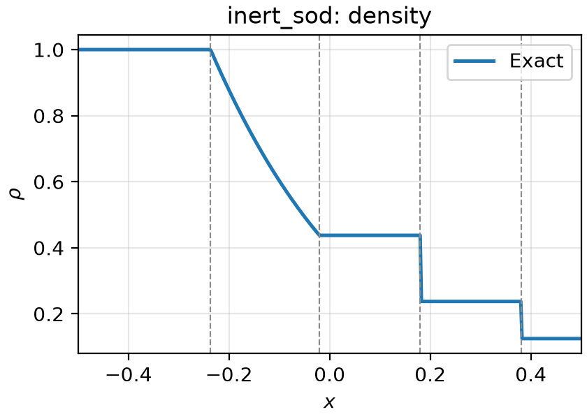 | 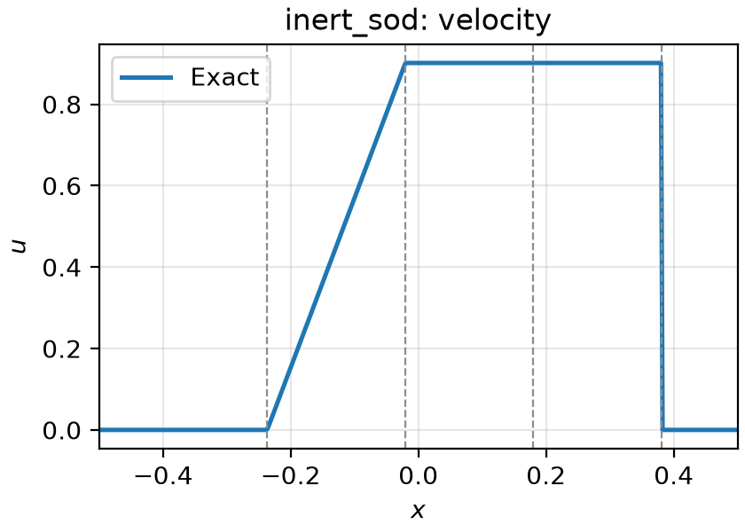 | 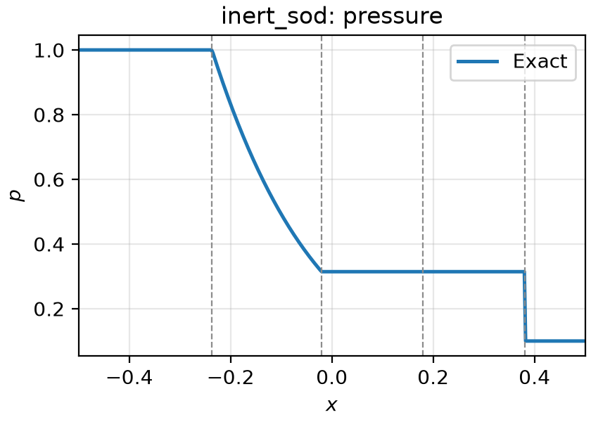 |

三联图：[overview.png](fig/inert_sod/overview.png)

## 2. inert_stiffened_gas

Sod 问题的刚性气体推广，左右两侧状态方程均包含非零 p_inf， 用于检验状态方程和波速公式中的 p_inf 项。

**初始条件与计算参数**

| 参数 | 左状态 | 右状态 |
| --- | ---: | ---: |
| rho (kg/m^3) | 1 | 0.125 |
| u (m/s) | 0 | 0 |
| p (Pa) | 1 | 0.1 |
| gamma | 1.4 | 1.667 |
| p_inf (Pa) | 0.5 | 0.2 |
| 计算区域 | x = [-0.5, 0.5], x_c = 0 | t = 0.2, N = 400 |
| 数值参数 | newton, tol = 1.000000e-12, maxit = 1000 | |

**求解结果**

| 量 | 值 |
| --- | ---: |
| 中间压强 p* (Pa) | 0.293875 |
| 接触间断速度 u* (m/s) | 0.62958 |
| 左波后密度 rho*_L (kg/m^3) | 0.634768 |
| 右波后密度 rho*_R (kg/m^3) | 0.167911 |

**波系**

| 波 | 类型 | 速度 (m/s) |
| --- | --- | --- |
| 左波 | 稀疏波 | S_head = -1.449138, S_tail = -0.693642 |
| 接触间断 | - | S = 0.62958 |
| 右波 | 激波 | S_R = 2.463546 |

**结果图像**

| 密度 $\rho$ | 速度 $u$ | 压强 $p$ |
| :---: | :---: | :---: |
| 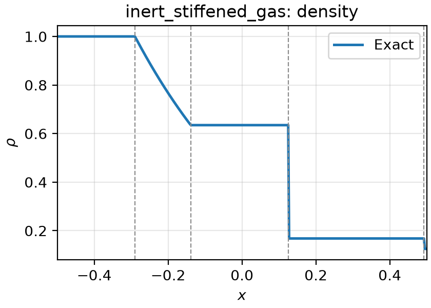 | 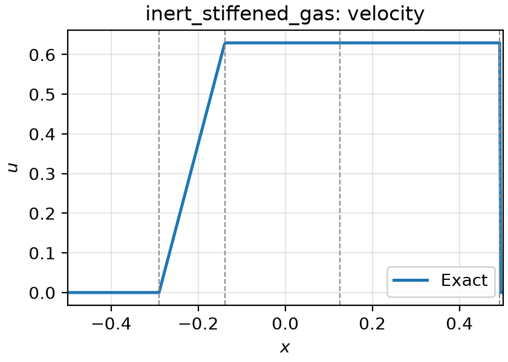 | 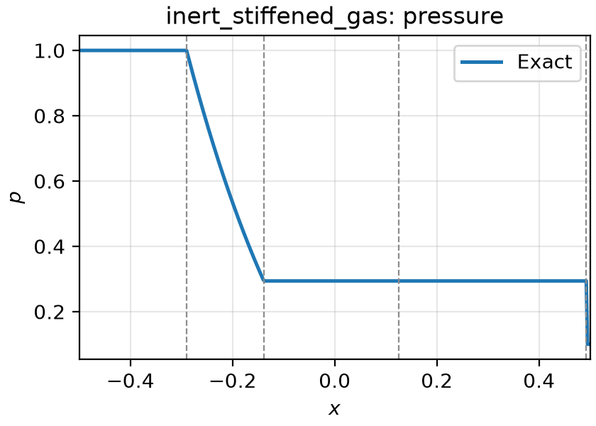 |

三联图：[overview.png](fig/inert_stiffened_gas/overview.png)

## 3. detonation_strong

强爆轰算例，波后状态恰为左端给定状态；右侧为 CJ 爆轰分支之上的强爆轰波。

**初始条件与计算参数**

| 参数 | 左状态 | 右状态 |
| --- | ---: | ---: |
| rho (kg/m^3) | 1.57861 | 0.601 |
| u (m/s) | 2799.82 | 0 |
| p (Pa) | 7.707520e+06 | 1.000000e+05 |
| gamma | 1.27 | 1.27 |
| q (J/kg) | 0 | 1.344444e+07 |
| 计算区域 | x = [0, 8], x_c = 4 | t = 5.000000e-04, N = 1200 |
| 数值参数 | newton, tol = 1.000000e-12, maxit = 1000 | |

**求解结果**

| 量 | 值 |
| --- | ---: |
| 中间压强 p* (Pa) | 7.707525e+06 |
| 接触间断速度 u* (m/s) | 2799.818699 |
| 左波后密度 rho*_L (kg/m^3) | 1.578611 |
| 右波后密度 rho*_R (kg/m^3) | 1.578611 |
| CJ 压强 p_CJ (Pa) | 4.518508e+06 |
| CJ 速度 u_CJ (m/s) | 1788.361788 |
| CJ 密度 rho_CJ (kg/m^3) | 1.063755 |

**波系**

| 波 | 类型 | 速度 (m/s) |
| --- | --- | --- |
| 左波 | 激波 | S_L = 309.690722 |
| 接触间断 | - | S = 2799.818699 |
| 右波 | 强爆轰波 | S_det = 4521.046909 |

**结果图像**

| 密度 $\rho$ | 速度 $u$ | 压强 $p$ |
| :---: | :---: | :---: |
| 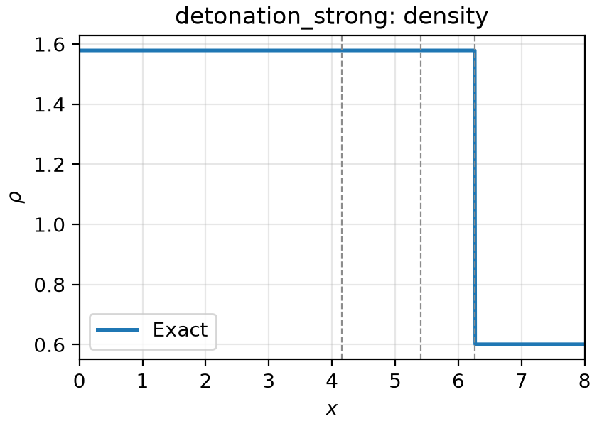 | 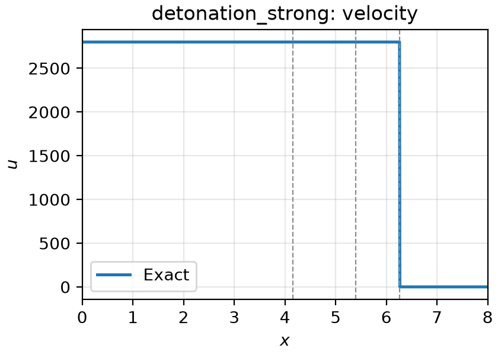 | 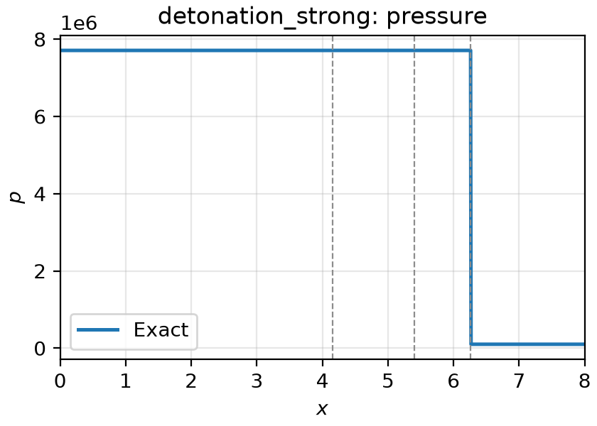 |

三联图：[overview.png](fig/detonation_strong/overview.png)

## 4. detonation_cj

CJ 爆轰算例，右侧为 CJ 爆轰波与稀疏波组成的复合波。

**初始条件与计算参数**

| 参数 | 左状态 | 右状态 |
| --- | ---: | ---: |
| rho (kg/m^3) | 0.974514 | 0.601 |
| u (m/s) | 1586.05 | 0 |
| p (Pa) | 4.042660e+06 | 1.000000e+05 |
| gamma | 1.27 | 1.27 |
| q (J/kg) | 0 | 1.344444e+07 |
| 计算区域 | x = [0, 8], x_c = 4 | t = 5.000000e-04, N = 1200 |
| 数值参数 | newton, tol = 1.000000e-12, maxit = 1000 | |

**求解结果**

| 量 | 值 |
| --- | ---: |
| 中间压强 p* (Pa) | 4.042660e+06 |
| 接触间断速度 u* (m/s) | 1586.049945 |
| 左波后密度 rho*_L (kg/m^3) | 0.974514 |
| 右波后密度 rho*_R (kg/m^3) | 0.974515 |
| CJ 压强 p_CJ (Pa) | 4.518508e+06 |
| CJ 速度 u_CJ (m/s) | 1788.361788 |
| CJ 密度 rho_CJ (kg/m^3) | 1.063755 |

**波系**

| 波 | 类型 | 速度 (m/s) |
| --- | --- | --- |
| 左波 | 激波 | S_L = -709.260449 |
| 接触间断 | - | S = 1586.049945 |
| 右波 | CJ 爆轰 + 稀疏波 | S_det = 4110.983671, S_tail = 3881.359729 |

**结果图像**

| 密度 $\rho$ | 速度 $u$ | 压强 $p$ |
| :---: | :---: | :---: |
| 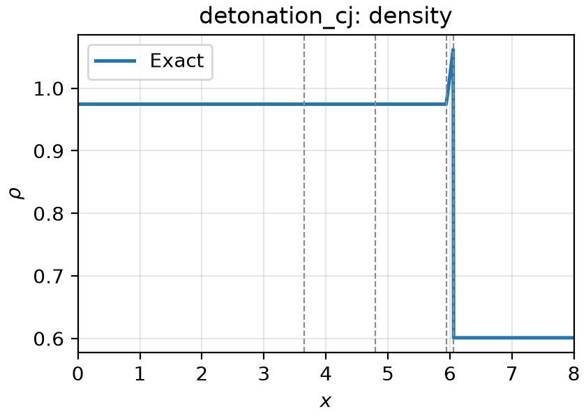 | 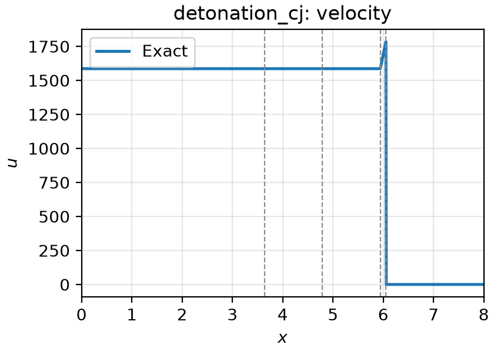 | 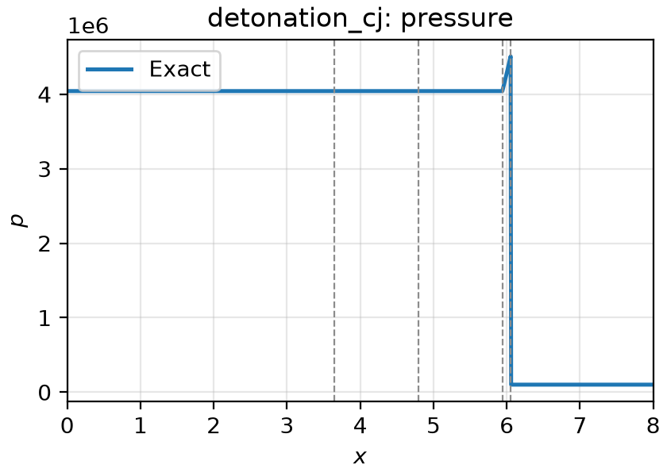 |

三联图：[overview.png](fig/detonation_cj/overview.png)

## 5. deflagration

爆燃波算例。右端为未燃气体，左端为已燃气体；火焰速度满足 V = u0 + K (p0/rho0)^Q。该算例中左波强度接近于零。

**初始条件与计算参数**

| 参数 | 左状态 | 右状态 |
| --- | ---: | ---: |
| rho (kg/m^3) | 0.142168 | 1 |
| u (m/s) | -181.018 | 0 |
| p (Pa) | 9.456950e+04 | 1.000000e+05 |
| gamma | 1.4 | 1.4 |
| q (J/kg) | 0 | 2.000000e+06 |
| 计算区域 | x = [0, 1.6], x_c = 0.8 | t = 5.000000e-04, N = 1000 |
| 数值参数 | brent, tol = 1.000000e-12, maxit = 10000 | |

**求解结果**

| 量 | 值 |
| --- | ---: |
| 火焰波后压强 p1 (Pa) | 9.456951e+04 |
| 接触间断速度 u1 (m/s) | -181.018081 |
| 火焰波后密度 rho1 (kg/m^3) | 0.142168 |
| 火焰波前压强 p0 (Pa) | 1.000001e+05 |
| 火焰波前速度 u0 (m/s) | 1.682704e-04 |
| 火焰波前密度 rho0 (kg/m^3) | 1 |
| 火焰速度 V (m/s) | 30.000179 |
| 左波后密度 rho*_L (kg/m^3) | 0.142168 |

**波系**

| 波 | 类型 | 速度 (m/s) |
| --- | --- | --- |
| 左波 | 激波 | S_L = -1146.043211 |
| 接触间断 | - | S = -181.018081 |
| 爆燃波 | 火焰 | V = 30.000179 |
| 右波 | 激波 | S_R = 374.16584 |

**结果图像**

| 密度 $\rho$ | 速度 $u$ | 压强 $p$ |
| :---: | :---: | :---: |
| 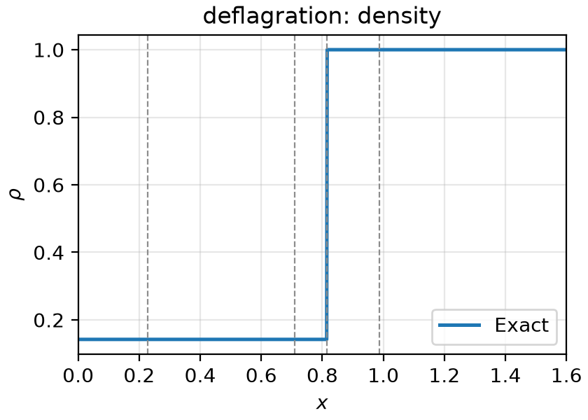 | 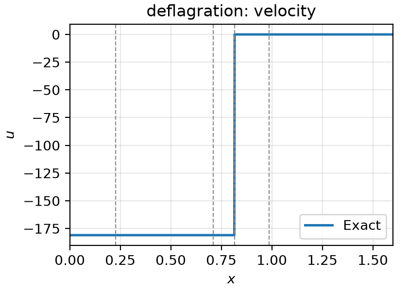 | 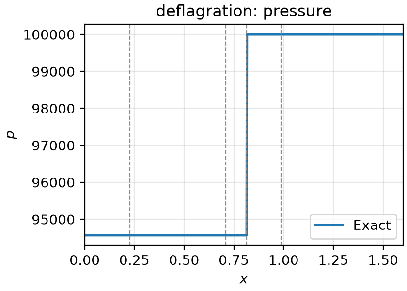 |

三联图：[overview.png](fig/deflagration/overview.png)

## 6. deflagration_uL0

与上一算例相同，但左端速度取 u_L = 0，左波为激波。

**初始条件与计算参数**

| 参数 | 左状态 | 右状态 |
| --- | ---: | ---: |
| rho (kg/m^3) | 0.142168 | 1 |
| u (m/s) | 0 | 0 |
| p (Pa) | 9.456950e+04 | 1.000000e+05 |
| gamma | 1.4 | 1.4 |
| q (J/kg) | 0 | 2.000000e+06 |
| 计算区域 | x = [0, 1.6], x_c = 0.8 | t = 5.000000e-04, N = 1000 |
| 数值参数 | brent, tol = 1.000000e-12, maxit = 10000 | |

**求解结果**

| 量 | 值 |
| --- | ---: |
| 火焰波后压强 p1 (Pa) | 1.151819e+05 |
| 接触间断速度 u1 (m/s) | -137.909786 |
| 火焰波后密度 rho1 (kg/m^3) | 0.171844 |
| 火焰波前压强 p0 (Pa) | 1.227385e+05 |
| 火焰波前速度 u0 (m/s) | 55.594403 |
| 火焰波前密度 rho0 (kg/m^3) | 1.157308 |
| 火焰速度 V (m/s) | 89.337499 |
| 左波后密度 rho*_L (kg/m^3) | 0.163633 |

**波系**

| 波 | 类型 | 速度 (m/s) |
| --- | --- | --- |
| 左波 | 激波 | S_L = -1051.31205 |
| 接触间断 | - | S = -137.909786 |
| 爆燃波 | 火焰 | V = 89.337499 |
| 右波 | 激波 | S_R = 409.0063 |

**结果图像**

| 密度 $\rho$ | 速度 $u$ | 压强 $p$ |
| :---: | :---: | :---: |
| 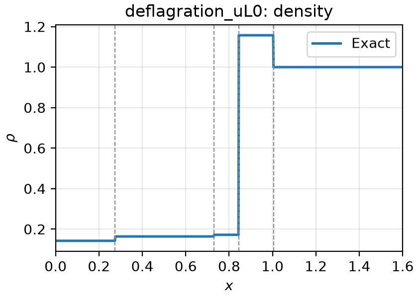 | 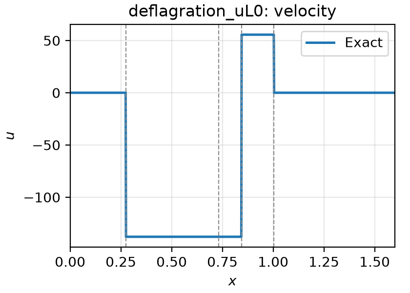 | 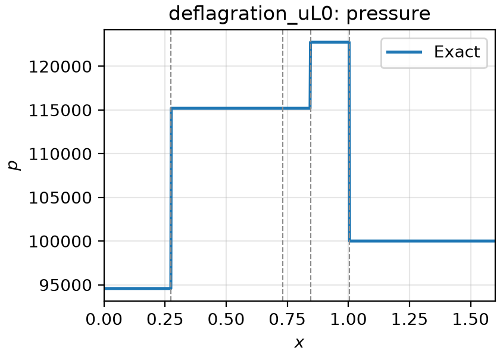 |

三联图：[overview.png](fig/deflagration_uL0/overview.png)

## 复现方式

```bash
cd CFD/Riemann/code
pip install -r requirements.txt
python run_cases.py                    # 运行全部算例
python run_cases.py --case inert_sod   # 只运行指定算例
python run_cases.py --list             # 列出全部算例
```

新增算例只需在 `cases.yaml` 的 `cases` 列表中追加一条记录，无需修改代码。
